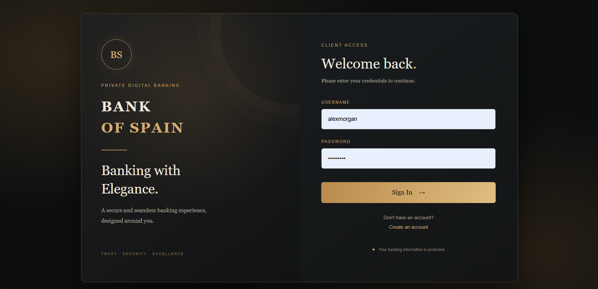
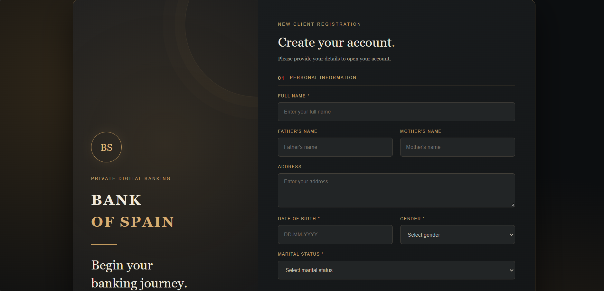
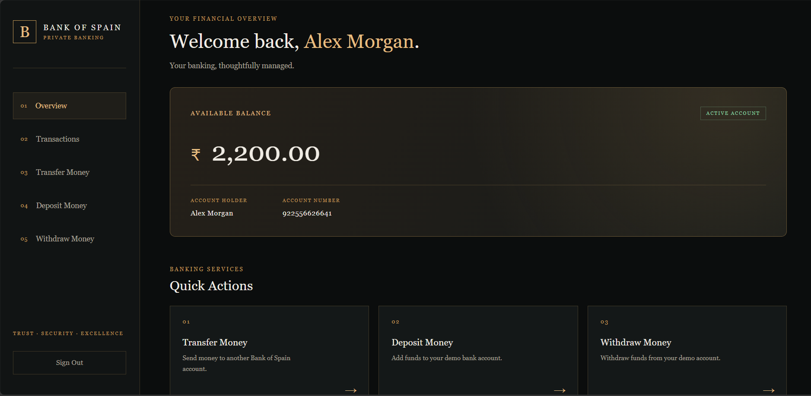
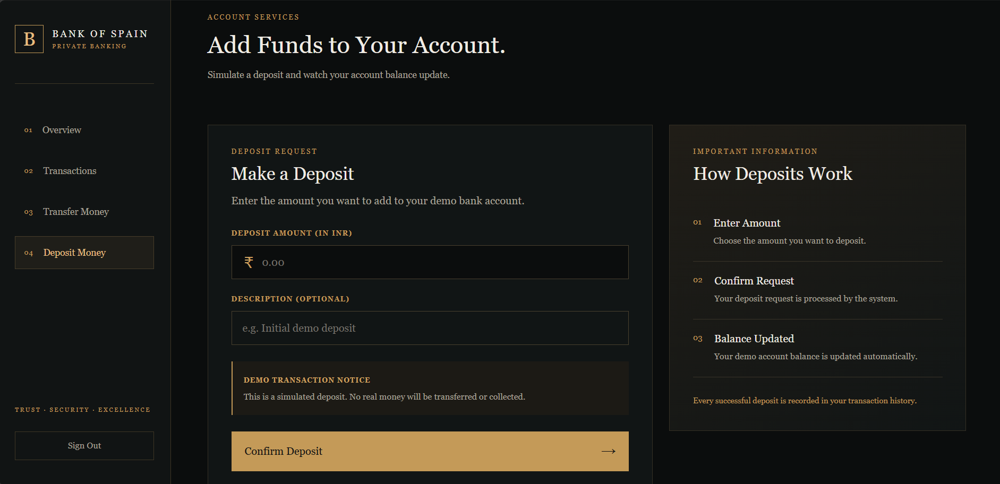
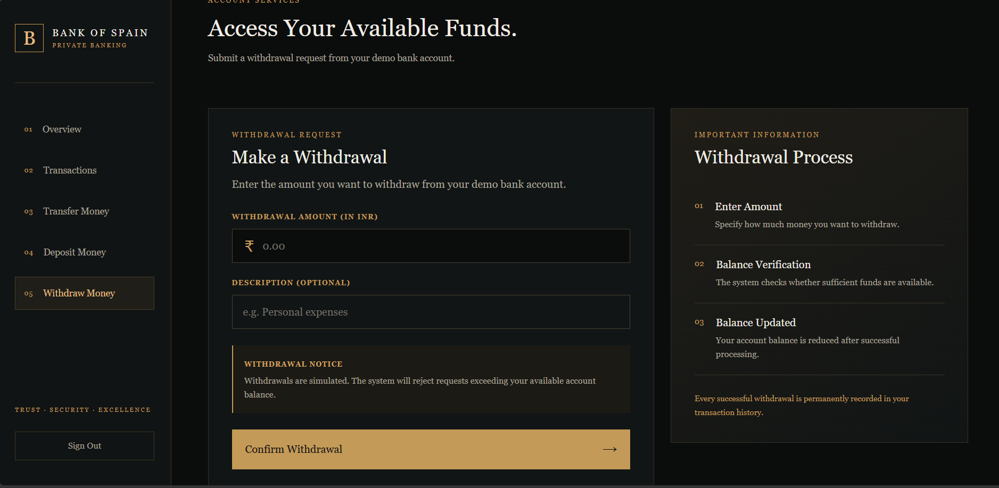
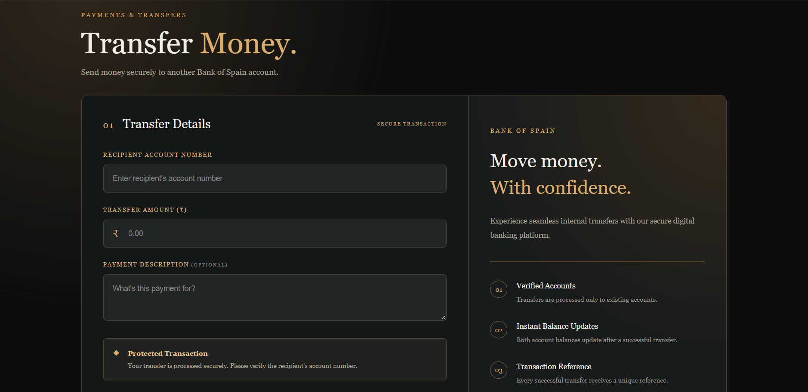
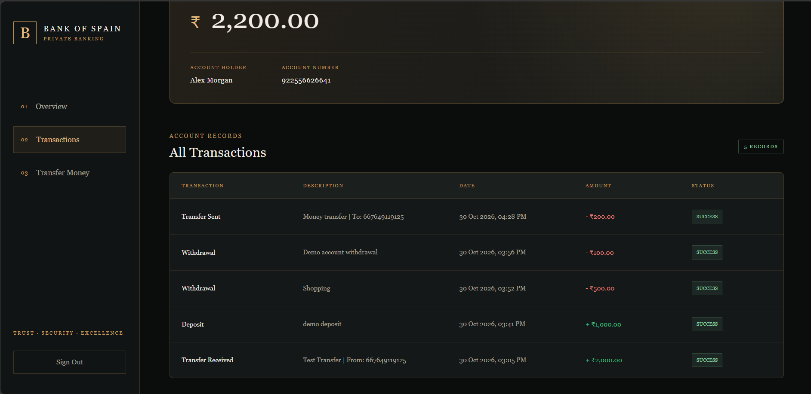

# Bank of Spain

A banking transaction management system built with Java and Spring Boot.

Bank of Spain is a personal project I developed to understand how a banking application works behind the scenes. I wanted to build something beyond a basic CRUD application, where users could create accounts, manage balances and transfer money between different accounts.

The application has a simple banking interface with a dark charcoal and antique gold theme.

**Please note:** This is a demonstration project. It does not connect to real banks or process actual financial transactions.

## About the Project

The application allows users to register and receive a unique 12 digit account number. After logging in, they can access their personal dashboard and perform different banking operations.

Every successful operation is stored in the database, so account balances and transaction histories remain updated even after logging out.


## Application Screenshots

Here are a few screenshots of the application.

### Login Page


### Registration Page


### Dashboard


### Deposit Money


### Withdraw Money


### Transfer Money


### Transaction History



## Features

### Account Management

Users can create an account by providing their personal details. Each registered user receives a unique 12 digit bank account number.

### User Authentication

Users can register and log in using their username and password. Passwords are securely hashed using BCrypt.

### Banking Operations

Users can deposit money, withdraw money and transfer funds to other registered accounts within the application.

The system checks available balances before processing withdrawals and transfers.

### Transaction History

Every successful deposit, withdrawal and transfer is recorded in the database. Users can view their account activity, including transaction descriptions, dates, amounts and status.

### Personal Dashboard

Each user has a separate dashboard displaying their account number, available balance and recent transactions.

## Technologies Used

**Backend:** Java 21, Spring Boot, Spring Security, Spring Data JPA

**Frontend:** HTML, CSS, Thymeleaf

**Database:** MySQL 9.1.0

**Build Tool:** Maven

**Development Tools:** IntelliJ IDEA, MySQL Workbench

## How It Works

The application follows a layered architecture.

The controller handles incoming requests from the user interface. The service layer contains the main application logic, while Spring Data JPA handles communication with the MySQL database.

Spring Security manages authentication, and Thymeleaf is used to display dynamic information on the frontend.

## Running the Project Locally

You will need Java 21, Maven and MySQL installed on your system.

First, create a database in MySQL:

```sql
CREATE DATABASE bank_of_spain;
```

Clone the repository:

```bash
git clone https://github.com/codewithsameer00/BankOfSpain.git
```

Open the project in IntelliJ IDEA.

Configure your MySQL connection in `application.properties` using your own database username and password.

Make sure your database name is `bank_of_spain`.

Run the main Spring Boot application class and open the following address in your browser:

```text
http://localhost:8080
```

## What I Learned

Building this project gave me practical experience with Spring Boot, database relationships, user authentication and transaction management.

One of the most interesting parts was implementing money transfers between accounts while making sure that both account balances and transaction records were updated together.

I also learned how to structure a Java application into controllers, services, repositories and entities.

## Project Status

The core banking operations are implemented and tested locally.

I plan to keep improving the project as I learn more about backend development and software engineering.

---

**Bank of Spain is an independent learning project created for educational and demonstration purposes.**
